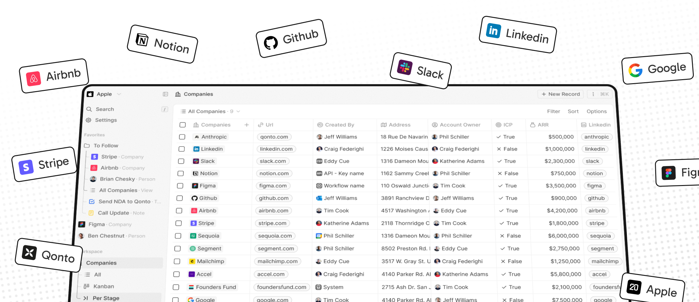
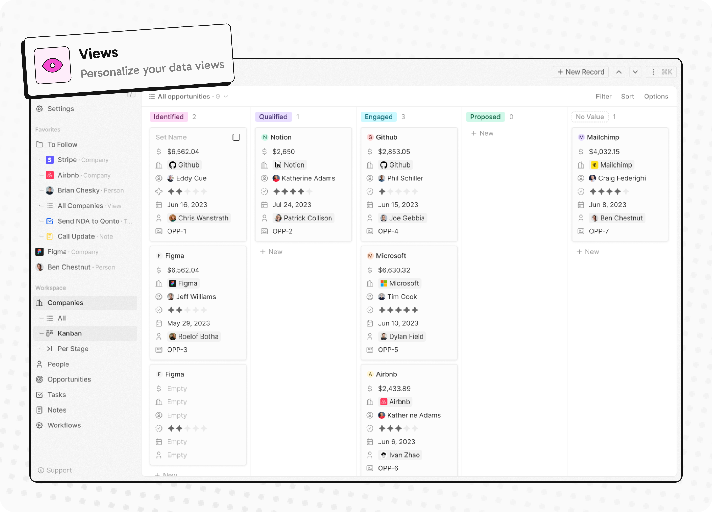
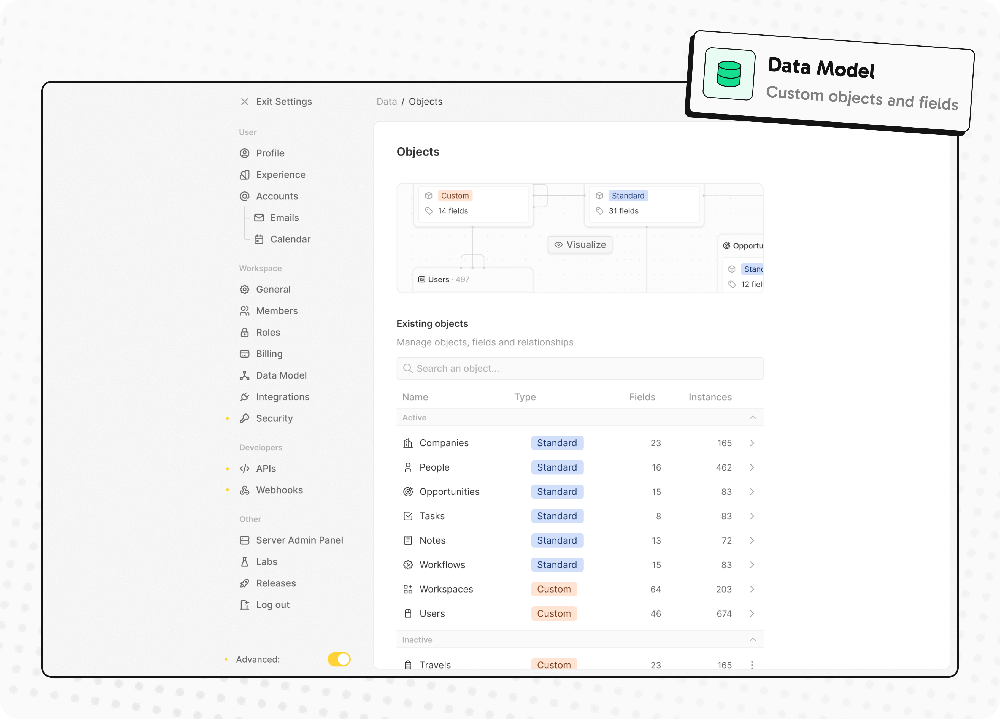
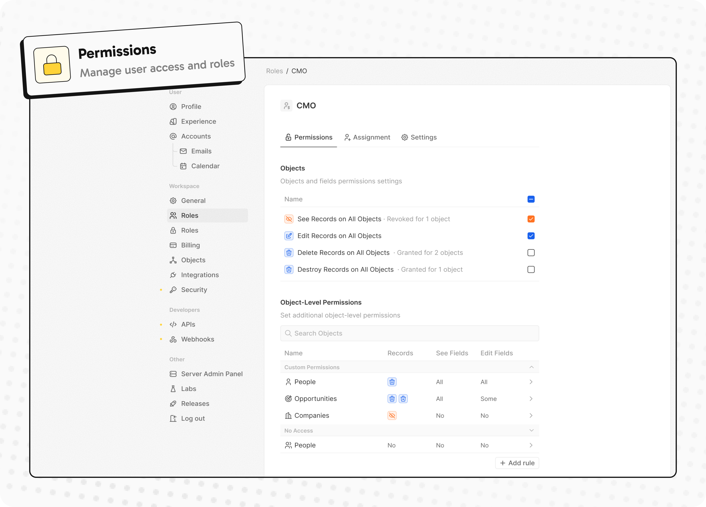
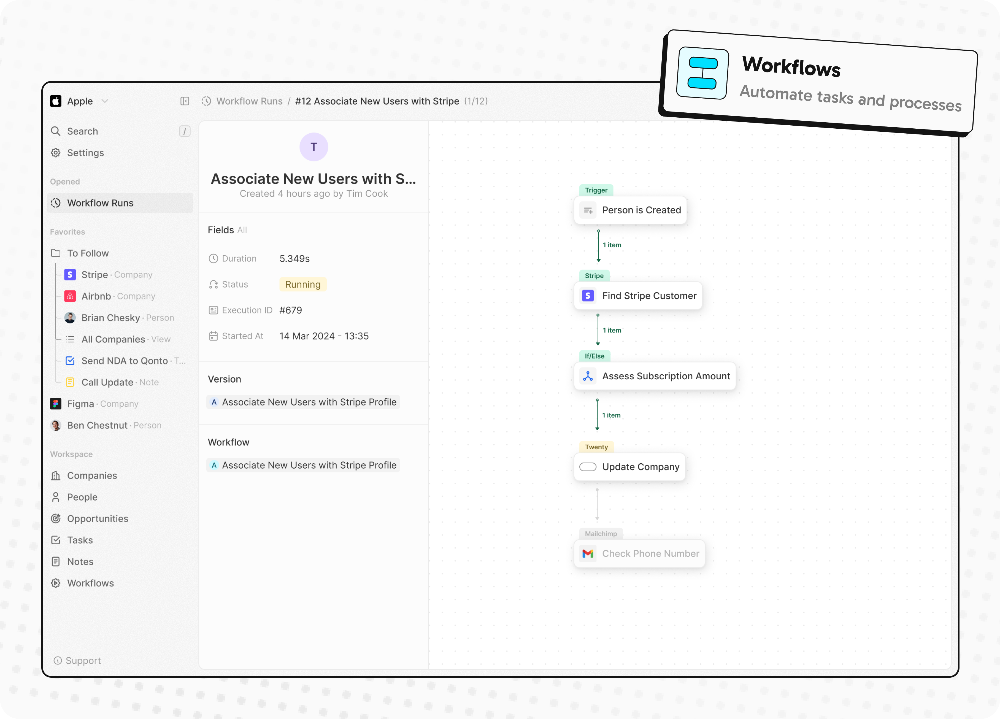
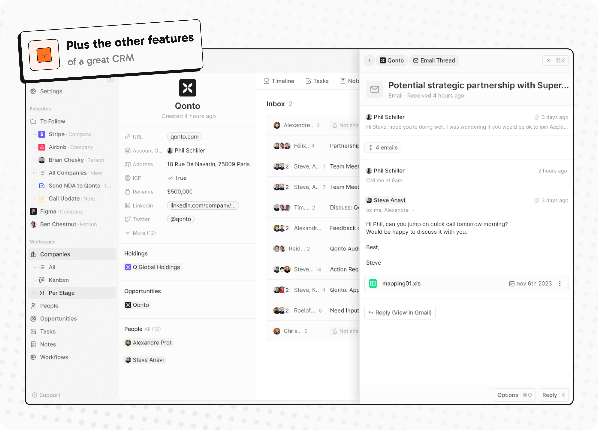

<p align="center">
  <a href="https://www.twenty.com">
    
  </a>
</p>

<h2 align="center" >The #1 Open-Source CRM </h2>

<p align="center"><a href="https://twenty.com">馃寪 Website</a> 路 <a href="https://docs.twenty.com">馃摎 Documentation</a> 路 <a href="https://github.com/orgs/twentyhq/projects/1"> Roadmap </a> 路 <a href="https://discord.gg/cx5n4Jzs57"> Discord</a> 路 <a href="https://www.figma.com/file/xt8O9mFeLl46C5InWwoMrN/Twenty">  Figma</a></p>
<br />


<p align="center">
  <a href="https://www.twenty.com">
    <picture>
      <source media="(prefers-color-scheme: dark)" srcset="https://raw.githubusercontent.com/twentyhq/twenty/refs/heads/main/packages/twenty-website/public/images/readme/github-cover-dark.png" />
      <source media="(prefers-color-scheme: light)" srcset="https://raw.githubusercontent.com/twentyhq/twenty/refs/heads/main/packages/twenty-website/public/images/readme/github-cover-light.png" />
      
    </picture>
  </a>
</p>

<br />

# Installation

See:
馃殌 [Self-hosting](https://docs.twenty.com/developers/self-host/capabilities/docker-compose)
馃枼锔?[Local Setup](https://docs.twenty.com/developers/contribute/capabilities/local-setup)

# Trade CRM Smoke Checks

From the repository root, run:

```bash
npm run verify:trade-crm-smoke
```

For CI or automation runners, use the quieter entry:

```bash
npm run verify:trade-crm-smoke:ci
```

To fail the smoke run when warnings are detected, use:

```bash
npm run verify:trade-crm-smoke:ci:strict
```

| Mode | Command | Behavior |
| --- | --- | --- |
| Development | `npm run verify:trade-crm-smoke` | Prints the full step-by-step execution log and writes the structured summary file. |
| Local pipeline | `npm run verify:trade-crm-smoke:local` | Runs the local PowerShell wrapper with the default local PostgreSQL, Redis, app secret, and assignee settings. |
| CI | `npm run verify:trade-crm-smoke:ci` | Prints only the final compact result, keeps warning counts in the summary, and stays green on known non-blocking warnings. |
| Strict CI | `npm run verify:trade-crm-smoke:ci:strict` | Uses the compact output and exits with failure when any warning is detected. |

The matching GitHub Actions workflow lives at `.github/workflows/ci-trade-crm-smoke.yaml`.
That workflow now also writes a compact GitHub job summary with smoke status,
warning codes, lead assignment register details, and the ops headline from the
latest smoke artifact.
The GitHub job summary now also surfaces the post-launch assignment stack
status, pool strategy, and the exported assignment-stack report/manifest paths
from the same smoke run.
The root smoke flow now also includes the category-first post-launch assignment
stack review, so the compact summary exposes
`postLaunchAssignmentStackStatus` and `postLaunchAssignmentPoolStrategy`
alongside the existing lead-assignment and ops fields.
The same root smoke run now also regenerates the post-launch assignment stack
bundle under `tmp/trade-crm-smoke/post-launch-assignment-stack-report/` and
exposes those artifact paths in the compact summary.
That same smoke flow now also runs a dedicated bundle verification step, so the
assignment-stack report, manifest, and copied source files are checked together
with the rest of the root smoke pipeline.
The compact smoke summary now also exposes
`assignmentStackBundledSourceCount`,
`assignmentStackCopiedBundledSourceCount`, and
`assignmentStackMissingBundledSourceCount` for that bundle.
It also exposes a compact `assignmentStackAuditSignal` in the format
`stackStatus:bundled/copied/missing`, for example
`waiting_for_category_confirmation:4/4/0`.
Processed outbox consumer details in the job summary now follow the same capped
display rule as the compact smoke headline and are surfaced there as the same
single compact audit token. The token format is `count:capped-list`, for
example `1:erp-sync=1` or `4:erp-sync=2|bi-sync=1|mail-sync=1|+1_more`.
The workflow summary also includes the matching human-readable
`processedOutboxConsumerAuditNarrative` so non-technical readers do not need to
parse the compact token alone. It now also includes the Chinese
`processedOutboxConsumerAuditNarrativeZh` for Chinese-facing CI readers.
It also supports `workflow_dispatch` with an `include_pg_state` toggle so you
can run the PostgreSQL-backed `integration-hub` state checks remotely without
turning them on for every PR by default.
For a file-and-script-level delivery audit against the current phase-1 module
plan, run:

```bash
npm run verify:trade-crm-phase1-delivery-audit
```

This writes:

- `tmp/trade-crm-delivery/phase1-delivery-audit.json`
- `tmp/trade-crm-delivery/phase1-delivery-audit.md`

The delivery audit is intentionally narrower than smoke/readiness. It checks
that the planned phase-1 work surfaces, shared shells, integration-hub
modules, verification commands, and close-out documents are all present in the
repository. It does not replace runtime validation.

For the phase-1 convergence close-out baseline (1.1.1 to 6.2.1), use:

```bash
npm run verify:trade-crm-phase1-convergence
```

To refresh readiness/smoke/trial artifacts and then generate the convergence
summary in one pass, use:

```bash
npm run verify:trade-crm-phase1-convergence:local
```

For a one-command local closeout run (convergence + UAT demo export + handoff
package export + weekly report export), use:

```bash
npm run verify:trade-crm-phase1-closeout:local
```

To enter the controlled phase-1 trial run state after refreshing closeout
artifacts, use:

```bash
npm run enter:trade-crm-phase1-trial-run:local
```

Trial-run state outputs:

- `tmp/trade-crm-trial-run/phase1-trial-run-state.json`
- `tmp/trade-crm-trial-run/phase1-trial-run-state.md`

The same local entry also exports the day-1 operating pack for field execution:

- `tmp/trade-crm-trial-run/phase1-trial-run-operating-pack.json`
- `tmp/trade-crm-trial-run/phase1-trial-run-operating-pack.md`
- `tmp/trade-crm-trial-run/phase1-trial-run-daily-report.json`
- `tmp/trade-crm-trial-run/phase1-trial-run-daily-report.md`
- `tmp/trade-crm-trial-run/phase1-trial-run-daily-history.jsonl`
- `tmp/trade-crm-trial-run/daily-archive/`

To refresh only the operating pack after updating sign-off or import-register
working files, run:

```bash
npm run export:trade-crm-phase1-trial-run-operating-pack
```

To refresh only the daily trial-run report after the operating pack and closeout
artifacts are current, run:

```bash
npm run export:trade-crm-phase1-trial-run-daily-report
```

Each daily report refresh preserves the latest JSON/MD outputs, appends one
JSONL history row, and writes timestamped JSON/MD archive files under
`tmp/trade-crm-trial-run/daily-archive/`.

Convergence outputs:

- `tmp/trade-crm-convergence/phase1-convergence-summary.json`
- `tmp/trade-crm-convergence/phase1-convergence-summary.md`

For the dual-view UAT demo script export (seller + manager reproducible path),
run:

```bash
npm run export:trade-crm-phase1-uat-demo-script
```

UAT demo outputs:

- `tmp/trade-crm-uat/phase1-uat-demo-script.json`
- `tmp/trade-crm-uat/phase1-uat-demo-script.md`

For the phase-1 handoff package export (code status + verification results +
known risks + next-stage entry), run:

```bash
npm run export:trade-crm-phase1-handoff-package
```

Handoff outputs:

- `tmp/trade-crm-handoff/phase1-handoff-package.json`
- `tmp/trade-crm-handoff/phase1-handoff-package.md`

For the unified weekly/progress report export based on the latest verification
artifacts, run:

```bash
npm run export:trade-crm-phase1-weekly-report
```

Weekly outputs:

- `tmp/trade-crm-weekly/phase1-weekly-report.json`
- `tmp/trade-crm-weekly/phase1-weekly-report.md`

Convergence baseline document:

- `docs/trade-crm-phase1-convergence-baseline-2026-04-15.md`

For local runtime trial runs where `serve` or `vite preview` are blocked in the
current environment, use the built-in static SPA preview server:

```bash
npm run serve:trade-crm-front:static
```

This serves `packages/twenty-front/build` on `http://127.0.0.1:4175` with
history fallback to `index.html`, so local routes such as `/sales-workbench`
can still be opened and used by `scripts/verify-sales-workbench-runtime-walkthrough.js`.
The workspace `/welcome` route now uses the branded `AMAIN CRM` auth shell,
with a top-right Chinese / English capsule that persists the UI locale before
sign-in.
For the current Trade CRM shell, the structured default landing route is
`/trade-crm/workbench`; if an already authenticated user manually opens
`/welcome`, the app should redirect back into that business shell instead of
staying on the auth welcome screen.

Before moving from local runtime verification into business-facing trial use,
run:

```bash
npm run verify:trade-crm-phase1-business-trial-readiness
npm run prepare:trade-crm-phase1-business-trial-pack
```

This writes:

- `tmp/trade-crm-trial/phase1-business-trial-readiness.json`
- `tmp/trade-crm-trial/phase1-business-trial-readiness.md`
- `tmp/trade-crm-trial/business-trial-pack/phase1-business-trial-pack-manifest.json`
- `tmp/trade-crm-trial/business-trial-pack/phase1-business-trial-pack-manifest.md`

The business-trial readiness audit checks that the seller SOP, manager SOP,
field/dictionary sheets, owner-routing confirmation sheets, post-launch staff
templates, and local runtime walkthrough evidence are all present before real
data trial operation starts.
The business-trial pack command then creates the seller sign-off sheet,
manager sign-off sheet, and import-register working files for the first live
trial round.
After business users fill those working files, review the current state with:

```bash
npm run review:trade-crm-phase1-business-trial-pack
```

This writes:

- `tmp/trade-crm-trial/business-trial-pack/phase1-business-trial-pack-review.json`
- `tmp/trade-crm-trial/business-trial-pack/phase1-business-trial-pack-review.md`

The review gate treats an `accepted` sign-off row as valid only when the
corresponding checklist fields are confirmed and the sign-off date is filled.
The review output now also includes row-level blocking reasons and suggested
next actions, so the business side can correct the working files directly.
The same business-trial pack can also carry sample CSV batches for
`Companies`, `People`, `Leads`, and `Opportunities` based on the phase-1
field configuration baseline.
Re-running the business-trial pack preparation keeps existing working files in
place and refreshes separate `.blank.csv` copies, so filled trial sheets are
not overwritten by the pack command.
Before treating the working pack as business-owned input, run
`npm run verify:trade-crm-phase1-business-trial-live-input` to confirm
sample/mock/example markers have been replaced.

For local overrides, copy `.env.trade-crm-smoke.example` to `.env.trade-crm-smoke`; the PowerShell wrapper loads it automatically.
If `TRADE_CRM_LEAD_ASSIGNMENT_RULES_JSON` is set, the same smoke flow verifies the
multi-member lead assignment route instead of the single default-assignee path.
You can also point `TRADE_CRM_LEAD_ASSIGNMENT_RULES_FILE` to a repo JSON file such
as `trade-crm-lead-assignment-rules.example.json` to avoid inlining rule arrays in
shell commands or `.env` files.
When no lead-assignment rules are explicitly set, the local PowerShell wrapper
now auto-detects `trade-crm-lead-assignment-rules.phase1-from-register.json`
and runs in `rules` mode by default if that file exists.
Set `TRADE_CRM_SMOKE_AUTO_DETECT_RULES=0` to disable this behavior.
When either rules input is provided, `verify:trade-crm-automations` now forces a
workflow reconcile run before assertion checks, so active workflows are validated
against the latest supplied rule set instead of stale published versions.
For a richer phase 1 routing starting point, see
`trade-crm-lead-assignment-rules.phase1-template.json`.
For a business-maintained register that can be edited in Excel first, see
`trade-crm-lead-assignment-rules.phase1-register.csv`.
The matching Chinese rollout note for sales operations lives in
`trade-crm-lead-assignment-rules.phase1-guide.md`.
For a stakeholder-facing confirmation draft before replacing placeholder owners,
see `trade-crm-lead-assignment-rules.phase1-approval-draft.md`.
For a business-facing CSV that stakeholders can fill in directly during routing review,
see `trade-crm-lead-assignment-rules.phase1-product-category-confirmation.csv`.
Recommended phase 1 routing workflow:

1. Review `trade-crm-lead-assignment-rules.phase1-approval-draft.md` with business stakeholders and confirm the phase 1 product categories plus pool strategy.
2. Collect the agreed category/pool/level decisions in `trade-crm-lead-assignment-rules.phase1-product-category-confirmation.csv`.
3. Use `trade-crm-lead-assignment-rules.phase1-guide.md` as the Chinese maintenance note for sales operations or implementation handoff.
4. Keep `trade-crm-lead-assignment-rules.phase1-template.json` as the JSON reference shape when a register is not being used.
5. After the routing model is finalized, update the technical register and validation tooling to reflect the approved product-category-first structure.
To summarize the current category-first confirmation progress, run:

```bash
npm --workspace packages/twenty-server run summarize:trade-crm-lead-assignment-product-category-confirmation
```

To review the current category-first launch readiness in one step, run:

```bash
npm --workspace packages/twenty-server run review:trade-crm-lead-assignment-product-category-confirmation
```

These commands are now the preferred path for the product-category-first rollout.
To validate the product-category confirmation sheet itself, run:

```bash
npm --workspace packages/twenty-server run verify:trade-crm-lead-assignment-product-category-confirmation
```

This checks duplicate categories, supported `assignmentMode`, supported
`decisionStatus`, and required `targetPool` values for pool-based routing.
The summarize/review output now also derives the current pool strategy directly
from the confirmation sheet, for example `shared_pool`,
`category_specific_pools`, or `shared_public_pool`, so you do not need to infer
that manually from the CSV.
After the category rows are approved, convert them into the next technical
handoff artifact with:

```bash
npm --workspace packages/twenty-server run convert:trade-crm-lead-assignment-product-category-confirmation
```

This generates
`trade-crm-lead-assignment.phase1-pool-routing.from-category-confirmation.json`
and carries forward only enabled rows whose `decisionStatus` is `Approved` or
`Confirmed`. With the current five category rows confirmed, the command can
produce a full category-pool routing artifact for phase 1.
To prepare the post-launch staffing maintenance sheet from the current
category-first pool strategy, run:

```bash
npm --workspace packages/twenty-server run generate:trade-crm-pool-staffing-template-from-category-confirmation
```

This generates
`trade-crm-lead-assignment.phase1-pool-staffing-template.csv` with one row per
enabled pool and placeholders for `staffLevel`, `memberName`, and `memberEmail`
so employees can be added, removed, or adjusted after launch without changing
the code path.
To prepare a separate post-launch staff-level template for those pools, run:

```bash
npm --workspace packages/twenty-server run generate:trade-crm-pool-staff-level-template-from-category-confirmation
```

This generates
`trade-crm-lead-assignment.phase1-pool-staff-level-template.csv` with one row
per pool and editable placeholders for `levelKey`, `levelName`, `sortOrder`,
and `isDefaultLevel`, so level maintenance can evolve independently from member
assignment.
To inspect the current post-launch level readiness from that template, run:

```bash
npm --workspace packages/twenty-server run summarize:trade-crm-pool-staff-level-template
npm --workspace packages/twenty-server run review:trade-crm-pool-staff-level-template
```

These commands show how many pool level rows are enabled, how many level keys
and names are filled, whether any default level is already marked, and whether
the template is still waiting for level configuration.
To validate uniqueness and default-level consistency in that template, run:

```bash
npm --workspace packages/twenty-server run verify:trade-crm-pool-staff-level-template
```

This verification checks duplicate `levelKey` values within the same pool,
duplicate `sortOrder` values within the same pool, and more than one default
level in the same pool. Empty level fields are still treated as pending
configuration rather than hard failures at this stage.
To review both post-launch staffing templates together in one step, run:

```bash
npm --workspace packages/twenty-server run review:trade-crm-post-launch-staffing-readiness
```

This combines the current pool staffing review and pool staff-level review into
one readiness result so you can quickly see whether the project is waiting for
members, waiting for levels, or ready for later runtime configuration.
To generate a combined runtime-facing draft from the current staffing and level
templates, run:

```bash
npm --workspace packages/twenty-server run generate:trade-crm-post-launch-runtime-assignment-config-draft
```

This generates `trade-crm-post-launch-runtime-assignment-config.draft.json` and
combines the current pool strategy, pool member rows, and pool level rows into a
single draft artifact. Empty members and empty levels are left out of the final
lists, but each pool is still retained so the current gap state remains visible.
To review that runtime-facing draft in one step, run:

```bash
npm --workspace packages/twenty-server run review:trade-crm-post-launch-runtime-assignment-config-draft
```

This reports which pools are already ready for later runtime wiring and which
ones still block on missing members, missing levels, or missing default levels.
To review whether the runtime draft is allowed to be promoted under
change-control rules, run:

```bash
npm --workspace packages/twenty-server run review:trade-crm-post-launch-runtime-assignment-activation-readiness
```

This combines stack readiness with an approval-record check and reports whether
the state is `ready_for_manual_activation` or still blocked.
Use `trade-crm-post-launch-runtime-assignment-activation.approval.template.json`
as the approval record template.
To initialize the approval record from template (idempotent), run:

```bash
npm --workspace packages/twenty-server run init:trade-crm-post-launch-runtime-assignment-activation-approval
```

This creates `trade-crm-post-launch-runtime-assignment-activation.approval.json`
when the file does not exist yet.
To export activation readiness as JSON/Markdown bundle for review handoff, run:

```bash
npm --workspace packages/twenty-server run export:trade-crm-post-launch-runtime-assignment-activation-report
```

This writes a bundle under
`tmp/trade-crm-post-launch-runtime-assignment-activation-report/`.
To enforce a strict activation gate (non-ready state exits with failure), run:

```bash
npm --workspace packages/twenty-server run verify:trade-crm-post-launch-runtime-assignment-activation-readiness
```

Use this as a pre-activation check or CI guard before manual promotion.
After readiness is `ready_for_manual_activation`, generate a candidate
activation register in dry-run mode:

```bash
npm --workspace packages/twenty-server run prepare:trade-crm-post-launch-runtime-assignment-activation-candidate
```

To execute manual activation (backup current register, apply candidate register,
and regenerate JSON rules from the activated register), run:

```bash
npm --workspace packages/twenty-server run activate:trade-crm-post-launch-runtime-assignment-config
```

Activation execution artifacts are written to:

- `tmp/trade-crm-post-launch-runtime-assignment-activation-execution/post-launch-runtime-assignment-activation-execution.json`
- `tmp/trade-crm-post-launch-runtime-assignment-activation-execution/post-launch-runtime-assignment-activation-execution.md`
To review the whole post-launch assignment stack in one step, run:

```bash
npm --workspace packages/twenty-server run review:trade-crm-post-launch-assignment-stack
```

This combines the category-first confirmation state, the staffing readiness
state, and the runtime draft state into one top-level result, so you can see
whether the project is still blocked by category confirmation, staffing/levels,
or is ready for later runtime wiring.
To export that stack review as JSON and Markdown artifacts, run:

```bash
npm --workspace packages/twenty-server run export:trade-crm-post-launch-assignment-stack-report
```

This writes a report bundle under
`tmp/trade-crm-post-launch-assignment-stack-report/` so the current stack status
can be reused in weekly/project reporting without rerunning each individual
command by hand. The bundle now also copies the current category confirmation
CSV, pool staffing template CSV, pool staff-level template CSV, and runtime
draft JSON into the same folder for handoff, and it writes
`post-launch-assignment-stack-bundle.manifest.json` so the bundle contents are
machine-readable.
For benchmark guidance on what this project should learn from Xiaoman / OKKI
without breaking the current `Twenty` / `integration-hub` boundary, see:

- `docs/trade-crm-xiaoman-benchmark-notes.md`

That note is the current reference for:

- action-first future workbench direction
- lead/customer/opportunity operating structure
- category-first routing justification
- explicit "learn this" vs "do not copy this" guidance

For the concrete next-phase workspace and operating-view direction derived from
that benchmark, see:

- `docs/trade-crm-action-first-workspace-draft.md`

For the first concrete implementation-planning slice of that direction, see:

- `docs/trade-crm-sales-workbench-ia-draft.md`

For the block-level source/filter/action mapping that should guide the next
sales workbench implementation round, see:

- `docs/trade-crm-sales-workbench-block-query-mapping-draft.md`

For the first route/component planning slice of that workbench, focused on the
top-priority blocks, see:

- `docs/trade-crm-sales-workbench-block-route-component-draft.md`

For the app-level route placement and ownership baseline for those same
top-priority blocks, see:

- `docs/trade-crm-sales-workbench-app-route-ownership-draft.md`

For the same planning slice translated into the current `packages/twenty-front`
page/module structure, see:

- `docs/trade-crm-sales-workbench-page-shell-module-draft.md`

For the exact route-registration and navigation-entry recommendation grounded in
the current `AppPath`, router, and navigation-drawer structure, see:

- `docs/trade-crm-sales-workbench-route-registration-navigation-decision-draft.md`

For the next code-facing navigation ownership decision, grounded in the current
workspace `navigation-menu-item` rendering path, see:

- `docs/trade-crm-sales-workbench-navigation-menu-item-registration-draft.md`

For the current decision on whether the default workbench navigation item
should be created through backend bootstrap or through the existing frontend
workspace navigation-item rollout path, see:

- `docs/trade-crm-sales-workbench-navigation-item-seed-bootstrap-decision-draft.md`

For the current implementation baseline for the CRM-native queue views used by
seller drill-down, see:

- `docs/trade-crm-sales-workbench-seeded-view-refinement-draft.md`
- `docs/trade-crm-runtime-assignment-activation-policy.md`

The first real frontend slice is now in place at a minimum shell level:

- `AppPath.SalesWorkbench`
- `pages/workbench/SalesWorkbenchPage.tsx`
- direct route registration in `useCreateAppRouter`
- a guarded frontend effect that creates a workspace-scoped `Sales Workbench`
  navigation entry when missing

The first data-backed workbench slice now goes one step further:

- `Today New Leads` now pulls the most recent `lead` records through
  `useFindManyRecords`, then applies a minimal 鈥渃reated today鈥?filter in the
  page layer
- `Tasks Due Today` now pulls `task` records through `useFindManyRecords`, then
  applies a minimal 鈥渃urrent assignee + due today + not done鈥?filter in the
  page layer
- both blocks keep drill-down behavior inside the existing native object list /
  record-detail paths instead of introducing a new backend API or hybrid adapter
- `Today New Leads` now prefers the seeded `Today New Leads` workspace view for
  its footer drill-down, falling back to the broader `Leads (Trade CRM)` view
  or the generic leads list if that queue view is missing
- `Tasks Due Today` now prefers the seeded `Tasks Due Today` workspace view for
  its footer drill-down, falling back to the broader `Tasks (Trade CRM)` view
  or the generic tasks list if that queue view is missing
- `My Pipeline Needing Next Action` now prefers the seeded
  `Pipeline Needs Next Action` workspace view for its footer drill-down,
  falling back to the broader `Pipeline (Trade CRM)` view or the generic
  opportunity list if that queue view is missing
- the Trade CRM backend initializer now seeds those three queue-specific views
  in addition to the original broad `Trade CRM` object views
- the seeded `Pipeline Needs Next Action` view now uses a grouped `OR`
  opportunity hygiene condition so it tracks the current workbench card more
  closely: missing `nextAction` or missing `nextActionDate`
- the current seller-facing workbench cards now use queue-oriented footer labels
  and cleaner middle-dot metadata separators so the first slice reads more like an
  action queue and less like a raw object list
- the CRM-native workbench cards now keep their preview lists capped to five rows
  while showing the real queue totals in the card count badges
- the hybrid `Lead First Response Risk` card now follows the same pattern,
  keeping the preview capped to five reminders while showing the real risk total in the badge
- the hybrid risk footer now prefers the existing `Leads (Trade CRM)` workspace view
  for seller-facing follow-up, while still falling back to the generic leads list when needed
- the hybrid risk block now uses seller-facing state copy for disconnected,
  unavailable, and no-risk states so the card reads like operational guidance
- the workbench page shell now groups the first slice into `Immediate Action` and
  `Pipeline Follow-Through` sections so today's queue work reads more clearly
- the `Tasks Due Today` card now includes a small seller-facing interaction hint
  so users know they can complete a task inline or open its detail panel from the workbench
- `Lead First Response Risk` now pulls the existing
  `integration-hub` endpoint `GET /api/lead-monitoring/first-response` through a
  workbench-local adapter and filters reminder rows to the current workspace
  member when `assignedToId` is present
- this hybrid block expects `REACT_APP_INTEGRATION_HUB_API_BASE_URL` in
  non-localhost environments; when the variable is missing, the card renders an
  explicit local empty-state prompt instead of silently failing
- the first-slice workbench cards now use more consistent seller-facing descriptions and queue-status empty states, so the current surface reads more like a unified action board
- the first-slice workbench cards now also reuse a small shared workbench text component for hint and empty-state presentation, keeping the current UX polish in one place
- the `Lead First Response Risk` and `My Pipeline Needing Next Action` cards now
  include small seller-facing hints so the full first slice uses a more consistent
  queue-guidance style across hybrid and CRM-native cards
- `My Pipeline Needing Next Action` now pulls the most recent `opportunity`
  records through `useFindManyRecords`, filters to the current seller via
  `ownerId`, excludes `WON` / `LOST`, and keeps the first version focused on
  opportunities missing `nextAction` or `nextActionDate`
- `My Pipeline Needing Next Action` now prefers the seeded
  `Pipeline Needs Next Action` workspace view for its footer drill-down, falling
  back to the generic opportunity list if that seeded view is missing

To review the current Sales Workbench phase-1 slice, including the four live cards,
their data sources, queue-count behavior, drill-down targets, and known validation
limits, see:
- docs/trade-crm-sales-workbench-phase1-verification-note.md
The latest local runtime evidence confirms frontend build success, stable
four-card rendering on `/sales-workbench`, and no remaining failed requests in
the walkthrough path.
- docs/trade-crm-sales-workbench-phase1-acceptance-checklist.md
The current local baseline includes a passing frontend production build via
`npx vite build` and a clean runtime walkthrough pass
(`scripts/verify-sales-workbench-runtime-walkthrough.js`); `OI-010` and
`OI-011` are closed.
To inspect the current post-launch staffing readiness from that template, run:

```bash
npm --workspace packages/twenty-server run summarize:trade-crm-pool-staffing-template
npm --workspace packages/twenty-server run review:trade-crm-pool-staffing-template
```

These commands show how many pool rows are enabled, how many staff levels are
filled, how many member names/emails are already assigned, and whether the
template is still waiting for staffing members.
To validate filled member emails against actual workspace members, run:

```bash
npm --workspace packages/twenty-server run verify:trade-crm-pool-staffing-template
```

This verification keeps empty `memberEmail` rows as pending staffing work, but
it fails if any filled email does not resolve to exactly one workspace member in
the current workspace.
To convert the business confirmation sheet into the technical register shape, run:

```bash
npm --workspace packages/twenty-server run convert:trade-crm-lead-assignment-business-confirmation
```

By default this writes `trade-crm-lead-assignment-rules.phase1-from-business-confirmation.csv`
at the repo root. Override the source or output path with
`TRADE_CRM_LEAD_ASSIGNMENT_BUSINESS_CONFIRMATION_FILE` or
`TRADE_CRM_LEAD_ASSIGNMENT_REGISTER_OUTPUT_FILE`.
To summarize the current confirmation progress before conversion, run:

```bash
npm --workspace packages/twenty-server run summarize:trade-crm-lead-assignment-business-confirmation
```

This prints total rows, approved rows, pending rows, disabled rows, missing owner emails,
and an actionable list of rows that still block conversion into the technical register.
To compare the generated candidate register against the current technical register before overwrite, run:

```bash
npm --workspace packages/twenty-server run compare:trade-crm-lead-assignment-registers
```

By default this compares `trade-crm-lead-assignment-rules.phase1-register.csv`
with `trade-crm-lead-assignment-rules.phase1-from-business-confirmation.csv`.
Override the candidate path with `TRADE_CRM_LEAD_ASSIGNMENT_CANDIDATE_REGISTER_FILE`.
To run summary, conversion, and register comparison together as one routing review step, run:

```bash
npm --workspace packages/twenty-server run review:trade-crm-lead-assignment-business-confirmation
```

This emits one consolidated JSON result showing whether the current state is
still waiting for business confirmation, has no register delta, or has a candidate
delta ready for technical review.
To apply the candidate register to the current technical register after review, run:

```bash
npm --workspace packages/twenty-server run apply:trade-crm-lead-assignment-register-candidate
```

This apply step is guarded: it refuses to overwrite the current register when the
candidate register is empty or when the candidate would remove every current rule.
When it does apply changes, it writes a timestamped `.bak` copy of the current
technical register first.
To verify only the business-confirmation conversion flow with a temporary mixed-status sample, run:

```bash
npm --workspace packages/twenty-server run verify:trade-crm-lead-assignment-business-confirmation
```

Each rule can optionally set `priority`; lower numbers run first, and when
priority is equal the initializer falls back to more specific rules before
broader ones. Conflicting or shadowed rules now fail the automation
initialization instead of silently publishing ambiguous routing logic.
To validate only the lead assignment file without publishing workflows, run:

```bash
npm --workspace packages/twenty-server run verify:trade-crm-lead-assignment-rules
```

Example with the phase 1 template:

```bash
TRADE_CRM_LEAD_ASSIGNMENT_RULES_FILE=trade-crm-lead-assignment-rules.phase1-template.json npm --workspace packages/twenty-server run verify:trade-crm-lead-assignment-rules
```

To convert the CSV register into a JSON rules file before validation or publish:

```bash
npm --workspace packages/twenty-server run convert:trade-crm-lead-assignment-rules-register
```

By default this writes `trade-crm-lead-assignment-rules.phase1-from-register.json`
at the repo root. Override the source or output path with
`TRADE_CRM_LEAD_ASSIGNMENT_REGISTER_FILE` or
`TRADE_CRM_LEAD_ASSIGNMENT_RULES_OUTPUT_FILE`.

To run conversion plus workspace-backed validation in one step:

```bash
npm --workspace packages/twenty-server run verify:trade-crm-lead-assignment-register
```

This project-level smoke flow verifies:

- Lead assignment register conversion and workspace-backed validation
- Trade CRM opportunity stage configuration
- Trade CRM phase 1 workflow automations
- Alibaba lead ingestion create/update path
- Lead first-response monitoring flow
- Twenty webhook routing and health summary

The latest structured smoke summary is written to:

```text
tmp/trade-crm-smoke/last-smoke-summary.json
```

The same artifact directory also receives the latest exported integration-hub
ops files from the `state-persistence-flow` check:

```text
tmp/trade-crm-smoke/ops-state.json
tmp/trade-crm-smoke/ops-exceptions.json
tmp/trade-crm-smoke/ops-report.md
tmp/trade-crm-smoke/ops-weekly-summary.md
```

The smoke summary JSON also includes an `opsSnapshotSummary` block so the final
CI output can show a short operational headline without opening the Markdown
artifacts.
That same block now exposes `stateBackend`, so the compact smoke result can
show whether the latest ops snapshot came from the file or PostgreSQL backend.
It also surfaces `processedOutboxConsumers` when processed outbox events have
been acknowledged by named downstream consumers, together with
`processedOutboxConsumerCount` and a combined
`processedOutboxConsumerAuditSignal` for compact CI reporting. A matching
plain-language `processedOutboxConsumerAuditNarrative` is also included in the
smoke summary for easier reuse in human-facing status outputs. The same summary
now also includes `processedOutboxConsumerAuditNarrativeZh` for Chinese-facing
status or weekly report reuse.
It also records `leadAssignmentMode` and `leadAssignmentRuleCount` so CI output
shows whether the run used the default assignee fallback or the configured
multi-member routing rules. When the register-based check runs, the summary also
includes `leadAssignmentRegisterFile`,
`leadAssignmentGeneratedRulesFile`,
`leadAssignmentRegisterRuleCount`, and
`leadAssignmentRegisterWorkspaceId`.
Set `TRADE_CRM_SMOKE_INCLUDE_PG_STATE=1` (or pass `--include-pg-state`) when
you want the project smoke flow to also run the PostgreSQL-backed
`integration-hub` state checks.

Known warning during the `trade-crm-automations` check:

- `DEP0169 url.parse()` is emitted by the existing `bcrypt -> @mapbox/node-pre-gyp` dependency chain, not by the custom Trade CRM code.
- The traced source recorded in the smoke summary points to `node_modules/bcrypt/node_modules/@mapbox/node-pre-gyp/lib/util/versioning.js:332`.
- This warning is currently non-blocking: the Trade CRM automations verification still passes and the smoke flow remains green.
- The strict CI variant will currently fail on this warning until the upstream dependency chain is replaced or upgraded.

# Why Twenty

We built Twenty for three reasons:

**CRMs are too expensive, and users are trapped.** Companies use locked-in customer data to hike prices. It shouldn't be that way.

**A fresh start is required to build a better experience.** We can learn from past mistakes and craft a cohesive experience inspired by new UX patterns from tools like Notion, Airtable or Linear.

**We believe in open-source and community.** Hundreds of developers are already building Twenty together. Once we have plugin capabilities, a whole ecosystem will grow around it.

<br />

# What You Can Do With Twenty

Please feel free to flag any specific needs you have by creating an issue.

Below are a few features we have implemented to date:

+ [Personalize layouts with filters, sort, group by, kanban and table views](#personalize-layouts-with-filters-sort-group-by-kanban-and-table-views)
+ [Customize your objects and fields](#customize-your-objects-and-fields)
+ [Create and manage permissions with custom roles](#create-and-manage-permissions-with-custom-roles)
+ [Automate workflow with triggers and actions](#automate-workflow-with-triggers-and-actions)
+ [Emails, calendar events, files, and more](#emails-calendar-events-files-and-more)


## Personalize layouts with filters, sort, group by, kanban and table views

<p align="center">
    <picture>
      <source media="(prefers-color-scheme: dark)" srcset="https://raw.githubusercontent.com/twentyhq/twenty/refs/heads/main/packages/twenty-website/public/images/readme/views-dark.png" />
      <source media="(prefers-color-scheme: light)" srcset="https://raw.githubusercontent.com/twentyhq/twenty/refs/heads/main/packages/twenty-website/public/images/readme/views-light.png" />
      
    </picture>
</p>

## Customize your objects and fields

<p align="center">
    <picture>
      <source media="(prefers-color-scheme: dark)" srcset="https://raw.githubusercontent.com/twentyhq/twenty/refs/heads/main/packages/twenty-website/public/images/readme/data-model-dark.png" />
      <source media="(prefers-color-scheme: light)" srcset="https://raw.githubusercontent.com/twentyhq/twenty/refs/heads/main/packages/twenty-website/public/images/readme/data-model-light.png" />
      
    </picture>
</p>

## Create and manage permissions with custom roles

<p align="center">
    <picture>
      <source media="(prefers-color-scheme: dark)" srcset="https://raw.githubusercontent.com/twentyhq/twenty/refs/heads/main/packages/twenty-website/public/images/readme/permissions-dark.png" />
      <source media="(prefers-color-scheme: light)" srcset="https://raw.githubusercontent.com/twentyhq/twenty/refs/heads/main/packages/twenty-website/public/images/readme/permissions-light.png" />
      
    </picture>
</p>

## Automate workflow with triggers and actions

<p align="center">
    <picture>
      <source media="(prefers-color-scheme: dark)" srcset="https://raw.githubusercontent.com/twentyhq/twenty/refs/heads/main/packages/twenty-website/public/images/readme/workflows-dark.png" />
      <source media="(prefers-color-scheme: light)" srcset="https://raw.githubusercontent.com/twentyhq/twenty/refs/heads/main/packages/twenty-website/public/images/readme/workflows-light.png" />
      
    </picture>
</p>

## Emails, calendar events, files, and more

<p align="center">
    <picture>
      <source media="(prefers-color-scheme: dark)" srcset="https://raw.githubusercontent.com/twentyhq/twenty/refs/heads/main/packages/twenty-website/public/images/readme/plus-other-features-dark.png" />
      <source media="(prefers-color-scheme: light)" srcset="https://raw.githubusercontent.com/twentyhq/twenty/refs/heads/main/packages/twenty-website/public/images/readme/plus-other-features-light.png" />
      
    </picture>
</p>

<br />

# Stack
- [TypeScript](https://www.typescriptlang.org/)
- [Nx](https://nx.dev/)
- [NestJS](https://nestjs.com/), with [BullMQ](https://bullmq.io/), [PostgreSQL](https://www.postgresql.org/), [Redis](https://redis.io/)
- [React](https://reactjs.org/), with [Jotai](https://jotai.org/), [Linaria](https://linaria.dev/) and [Lingui](https://lingui.dev/)


# Thanks

<p align="center">
  <a href="https://www.chromatic.com/"></a>
  <a href="https://greptile.com"></a>
  <a href="https://sentry.io/"></a>
  <a href="https://crowdin.com/"></a>
  <a href="https://e2b.dev/"></a>
</p>

  Thanks to these amazing services that we use and recommend for UI testing (Chromatic), code review (Greptile), catching bugs (Sentry) and translating (Crowdin).


# Join the Community

- Star the repo
- Subscribe to releases (watch -> custom -> releases)
- Follow us on [Twitter](https://twitter.com/twentycrm) or [LinkedIn](https://www.linkedin.com/company/twenty/)
- Join our [Discord](https://discord.gg/cx5n4Jzs57)
- Improve translations on [Crowdin](https://twenty.crowdin.com/twenty)
- [Contributions](https://github.com/twentyhq/twenty/contribute) are, of course, most welcome!


